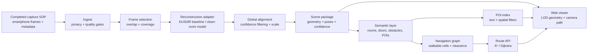

# makeify — An Indoor Spatial Engine

> **From a phone walkthrough to a place you can explore, search, and navigate.**

We built **makeify** for **Namma Space by Techfest, IIT Bombay**. The goal is straightforward: take ordinary smartphone videos or photos of an indoor space and turn them into an interactive 3D digital twin. Instead of just generating a static 3D model, we want a scene you can actually open in a browser, search for specific spots, and use to find safe walking routes around obstacles.

This repository is our project’s home base. It holds our system architecture, capture rules, evaluation plans, and licensing boundaries in one place. We have already run our capture SOP (Standard Operating Procedure) and initial reconstruction pipeline once; this repo exists to make our next steps repeatable and easy to verify.

> **License boundary:** DUSt3R code and checkpoints are subject to CC BY-NC-SA 4.0 and the licenses of their datasets and base checkpoints. This repository does not relicense those materials for commercial use.

---

## The idea in one sentence

**makeify builds a navigable digital twin from a phone-based indoor capture, then turns that twin into a useful spatial interface rather than leaving it as a beautiful but inert point cloud.**

That distinction is the whole point of our design. Getting a 3D reconstruction is just step one. For the twin to actually be useful, it has to answer practical questions like:

- Where is the reception desk?
- Can I move from this room to that room without passing through a wall?
- What does the space look like from another viewpoint?
- Which path is available when an obstacle blocks the shortest route?

Because of that, we treat the 3D geometry, room labels (semantics), search, navigation, and web viewer as one connected product rather than separate experiments.

## What the competition asks for

The Namma Space brief asks for an engine that turns standard smartphone captures of indoor spaces into interactive 3D digital twins. The competition breaks down into three main phases: 3D reconstruction and free roaming, POI (Point of Interest) search and navigation, and a live on-site capture and demo at IIT Bombay. [1]

For Round 1, we need to submit a technical abstract, a proof-of-concept web viewer, a code repository, and a 3–5 minute demo video showing free roaming. Later rounds bring in POI tagging, search indexing, obstacle-aware navigation, and a fresh capture done live on campus. [1]

The competition rules require proper credit and licensing for all open-source tools, with all extra links bundled into a single master PDF. Since the brief doesn't specify a strict page count, word limit, or font size for the abstract, we noted that directly in [`docs/problem-statement.md`](docs/problem-statement.md) rather than making up arbitrary formatting rules.

---

## What exists in this repository today

Right now, we have DUSt3R running as our core reconstruction engine in [`demo.py`](demo.py). You feed it multiple photos of a room, and it runs pairwise inference, aligns the resulting pointmaps, strips out low-confidence noise, and exports a colored `.glb` 3D model through a Gradio interface. It works well enough to prove our concept and generate the example outputs in this repo, though the raw geometry isn't yet clean enough to handle every tricky indoor room out of the box.

We aren't hiding that limitation—fixing it is the main engineering challenge ahead of us. While the current code handles the image-to-3D step, hitting the full Namma Space target means we still need to build out a cleaner scene package, semantic POI tags, a search index, a walkable floor grid, obstacle-aware routing (so users don't clip through walls), and a smooth web viewer that runs on any device without compatibility headaches. Our immediate focus is tightening up how we capture rooms, align frames, filter out bad points, and lock in consistent scene scale.

## Why DUSt3R is a strong research starting point

DUSt3R (Dense and Unconstrained Stereo 3D Reconstruction) is a deep learning pipeline built specifically to make 3D reconstruction from raw photos much more forgiving.

Traditionally, building a 3D scene from 2D photos runs into a classic chicken-and-egg problem: to figure out the 3D shape of a room, the software needs to know exact camera details (where the camera was standing, its tilt, and lens focal length). But to calculate those camera details, it needs to understand the 3D room first. Older Structure-from-Motion (SfM) tools like COLMAP solve this through heavy step-by-step feature matching—where a single blank white wall or dimly lit corner can break the whole reconstruction.

DUSt3R skips explicit camera calibration altogether. Instead, it looks at pairs of uncalibrated photos and directly predicts dense pointmaps—essentially 2D grids where every pixel holds an estimated $(X, Y, Z)$ 3D coordinate relative to the camera. When you give it more than two photos, its global alignment stage stitches all those pairs into one shared 3D space, figuring out camera positions, scale, and room geometry all at once. [2] [3] Because it handles messy, real-world footage so well, many modern SLAM frameworks now use DUSt3R under the hood.

For makeify, this makes DUSt3R a great **starting baseline**:

1. We can treat a smartphone walkthrough as a regular folder of photos rather than a calibrated laser survey.
2. It gives us 3D points, depth, image matches, and camera angles that the rest of our app can immediately use.
3. It outputs a confidence score for every point, telling us which parts of the room are solid and which parts are sketchy.
4. We can wrap the model inside a simple code adapter, so if we swap DUSt3R for another 3D engine later, the rest of our app doesn't break.

Our main architectural rule is simple: DUSt3R is just the reconstruction engine, not the whole project. It is one replaceable part inside a larger system.

### The research position

Our core hypothesis is straightforward:

> **A practical indoor digital twin is created by combining robust reconstruction with explicit uncertainty, lightweight semantics, and conservative navigation—not by optimizing visual geometry in isolation.**

That shapes the exact order in which we build:

1. Get a coherent 3D scene from the photos.
2. Filter out the noise and align the frames.
3. Compress the geometry so a normal web browser can actually load it.
4. Add the semantic layer (labeling doors, rooms, and desks).
5. Build the walkable floor graph and hook it up to the user interface.

A dense point cloud might look cool in a screenshot, but a genuinely useful digital twin needs to know where its own geometry is uncertain, what objects a user can search for, and where a person can safely walk.

---

## The system, from capture to experience



The editable Mermaid source for this diagram is in [`architecture/system.mmd`](architecture/system.mmd).

## Visual evidence

Here are our current prototype outputs, generated from a small set of indoor photos. They show the core promise of the pipeline: even before we finish adding room labels and pathfinding, a handful of phone photos can already become an interactive 3D scene complete with estimated camera positions. The next step is making this scene cleaner, searchable, and routable.


*Figure 1 — Current reconstruction output from the makeify prototype.*


*Figure 2 — Alternate view of the current reconstruction output, including estimated camera frustums.*

### 1. Capture

Everything starts with how the photos are taken. Our capture SOP ensures the person filming moves gradually, overlaps their shots, captures doorways from clear angles, and gets enough coverage of floors, ceilings, and corners. We also make sure faces, screens, and private details are avoided or blurred out right at the start.

To keep the final 3D model clean, we fuse the aligned pointmaps into a single scene, crop out stray background noise outside a set radius around the camera path, and convert the result into solid, collision-ready 3D geometry instead of leaving it as a messy raw point cloud.

Every capture session generates a manifest file logging the session ID, file paths, timestamps, phone model, walking order, and scene boundaries. This isn't just busywork—it's how we make sure any run can be repeated and debugged later.

### 2. Ingest and quality gates

Before running any AI models, the ingest step fixes image orientation, drops duplicate frames, checks for motion blur or bad lighting, and verifies that neighboring photos overlap enough. We keep the raw original files locked in staging and run reconstruction on a cleaned-up derivative set (resized and privacy-redacted copies of the originals), saving file hashes so we always know exactly which images produced which 3D model.

### 3. Reconstruction

Our reconstruction adapter takes the cleaned images and settings, and returns a standardized data structure:

```text
reconstruct(images, options) -> ReconstructionResult

ReconstructionResult:
  points: float32[N, 3]
  colors: uint8[N, 3]
  confidence: float32[N]
  cameras: Camera[]
  pair_matches: Match[]
  scale_status: {relative, metric, calibrated}
  provenance: ProvenanceRecord
```

Much like how an image file stores separate R, G, B, and Alpha channels for every pixel, our output groups data in parallel arrays: `points` (an $N \times 3$ array of $X, Y, Z$ coordinates), `colors` (an $N \times 3$ array of matching RGB values), and `confidence` (a 1D array of $N$ scores telling us how reliable each point is).

Whenever we run the DUSt3R baseline, we log the exact Git commit, model checkpoint hash, image resolution, hardware used, and inference settings. [3]

### 4. Alignment and geometry products

Next, we align the paired predictions into one shared coordinate system, throw out low-confidence points and floating outliers, and figure out which way is "up" based on the floor and camera angles. Unless we feed in a known real-world measurement (like a doorway of known width), we explicitly label the output as **relative scale** rather than pretending it is a millimeter-accurate architectural survey.

A web browser shouldn't be forced to load a massive, unfiltered research point cloud. Instead, our pipeline packages the scene into practical formats: a high-res master file, a lightweight decimated mesh for fast rendering, invisible collision walls, level-of-detail (LOD) tiles, and camera poses—all tagged with the source scene's hash and version.

### 5. Meaning and navigation

The semantic layer is what gives the raw 3D shapes actual meaning. It tags rooms, doors, stairs, obstacles, sketchy low-confidence zones, and Points of Interest (POIs). Each POI stores a unique ID, name, search aliases, category, 3D coordinates, the closest walkable floor node, and how it was labeled.

To handle walking routes, we flatten the space into a conservative 2.5D occupancy grid. Walls, furniture, closed doors, drop-offs, stairs, and uncertain areas get marked as blocked. Over the clear floor space, we build a walkable graph that runs **A\*** or **Dijkstra** pathfinding with adjustable wall clearance. If a path is completely blocked, the API catches it and returns a clear reason why (like a closed door or blocked hallway) instead of failing silently.

### 6. Viewer and service boundary

The web viewer grabs the scene manifest first, puts a lightweight 3D preview on screen immediately, and streams in higher-detail tiles as you look around. We kept the backend API intentionally simple:

```text
GET  /scenes/{scene_id}
GET  /scenes/{scene_id}/tiles/{tile_id}
GET  /scenes/{scene_id}/pois?q=...
POST /scenes/{scene_id}/routes
```

You can ask for a route between two POI names or two raw 3D coordinates. The server responds with the 3D path line (polyline) to draw on the floor, estimated distance, any warnings, and the exact scene version used.

---

## What makes the approach defensible

### It is end-to-end

We don't stop at an AI model demo. Our design connects photo capture, 3D reconstruction, mesh cleanup, room labeling, search, pathfinding, and the browser viewer. That matches how the competition actually judges projects, rather than hyper-optimizing one isolated step.

### It is honest about uncertainty

Shiny surfaces, blank walls, repetitive hallways, and blocked views can all mess with 3D reconstruction. Instead of hiding weak spots behind fake precision, our system tracks confidence scores and treats uncertain areas cautiously when calculating walking paths.

### It is modular

Our web viewer, POI search, and routing graph don't care if the 3D points came from DUSt3R, a custom-trained model, or another reconstruction tool. Keeping the 3D engine behind an adapter protects us from both technical and licensing lock-in.

### It is reproducible

A 3D output doesn't count unless we can recreate it. Every run is tied to its capture manifest, code version, model checkpoint hash, parameters, and dependency list using the templates in this repo.

### It is legally cautious

The official DUSt3R code is released under **CC BY-NC-SA 4.0**, and its pre-trained weights carry the licenses of their underlying training datasets. [3] That license allows sharing and modification for **NonCommercial** use with proper credit and ShareAlike terms. [4]

Because of that, we split our work into two clear tracks:

- **Track A — Research baseline:** Use upstream DUSt3R strictly inside a clearly labeled, non-commercial academic/competition environment while respecting all license terms.
- **Track B — Independent implementation:** Build any future commercial-ready components from scratch using public papers, clean-room code, and openly licensed datasets/weights.

A clean-room workflow reduces copyright risk, though it doesn't automatically make upstream DUSt3R weights commercial-friendly. Full details are laid out in [`docs/cleanroom-and-licensing.md`](docs/cleanroom-and-licensing.md).

---

## Evaluation that reflects the real experience

We test makeify as a complete product, not just a 3D model generator. Our internal scorecard mirrors the competition criteria: capture reliability, 3D quality, browser performance, search accuracy, safe pathfinding, and clear documentation. [1]

We track:

- Capture success rate when following our SOP;
- How completely rooms and hallways are reconstructed;
- Loop-closure drift (whether walking in a full circle lines back up) and scale consistency;
- Percentage of 3D points that pass our confidence threshold;
- How fast the browser draws the first frame and streams in detail;
- POI search accuracy;
- Route calculation success rate and zero wall-clipping violations;
- Clear explanations when no valid path exists; and
- Whether someone can reproduce a run from a fresh setup.

Our test suite needs to cover more than just one easy, well-lit room. At minimum, we test against a hallway loop, a cluttered room, a narrow doorway, a shiny or blank wall, and a blocked path. Those edge cases expose real weaknesses much faster than a cherry-picked demo.

---

## File formats in this repository

We wrote all documentation in Markdown (`.md`) so it reads cleanly on GitHub, and kept our architecture diagrams as editable Mermaid (`.mmd`) text files rather than static screenshots. This `README.md` is the main overview, while deeper technical and legal docs live in `docs/` and diagrams live in `architecture/`.

## Repository guide

| Path | Purpose |
|---|---|
| [`docs/problem-statement.md`](docs/problem-statement.md) | Official requirements, submission contract, and document-length audit |
| [`docs/technical-report.md`](docs/technical-report.md) | Detailed architecture, pipeline, API boundary, evaluation, and risks |
| [`docs/cleanroom-and-licensing.md`](docs/cleanroom-and-licensing.md) | Clean-room separation, provenance, licensing, and release gates |
| [`architecture/system.mmd`](architecture/system.mmd) | Source architecture diagram |
| [`configs/manifest.example.yaml`](configs/manifest.example.yaml) | Example capture and reconstruction manifest |
| [`third_party/NOTICE.md`](third_party/NOTICE.md) | Dependency, dataset, checkpoint, and model provenance register |
| [`viewer/`](viewer/) | Centered krpano ThreeJS/GLB browser viewer example |
| [`LICENSE`](LICENSE) | License for original repository material and third-party boundary |

*Note: We intentionally don't upload private room photos, heavy AI checkpoint files, or massive 3D exports directly to Git. Those live in controlled storage and are tracked via file hashes.*

---

## Current project status

- **Capture SOP:** Completed and tested once; serves as the starting input to our pipeline.
- **Implementation:** Working DUSt3R-based Gradio image-to-GLB script in `demo.py`.
- **Browser example:** Centered krpano + Three.js viewer in `viewer/`, loading `example outputs/2.glb` at the origin.
- **Result:** Pipeline runs end-to-end and generates usable 3D scenes, though raw mesh quality still needs cleanup for reliable automated pathfinding.
- **System design:** Fully mapped out from photo ingest to the web viewer, POI search, and routing API.
- **Licensing posture:** Upstream DUSt3R code/weights are kept strictly separated for non-commercial research use.
- **Submission documentation:** Technical report, requirement audit, architecture diagram, and provenance logs are all in place.
- **Next engineering focus:** Build the smallest complete end-to-end slice (3D scene + basic POI search + simple A* path) and stress-test it on difficult rooms before tweaking the AI model.

## Citation

If you use DUSt3R for non-commercial research evaluation, please cite the original paper and keep upstream license notices intact:

```bibtex
@InProceedings{Wang_2024_CVPR,
  author    = {Wang, Shuzhe and Leroy, Vincent and Cabon, Yohann and Chidlovskii, Boris and Revaud, Jerome},
  title     = {DUSt3R: Geometric 3D Vision Made Easy},
  booktitle = {Proceedings of the IEEE/CVF Conference on Computer Vision and Pattern Recognition},
  year      = {2024},
  pages     = {20697--20709}
}
```

## References

[1]: https://techfest.org/competitions/nammaspace "Namma Space — Techfest, IIT Bombay"
[2]: https://arxiv.org/abs/2312.14132 "DUSt3R: Geometric 3D Vision Made Easy — arXiv abstract"
[3]: https://github.com/naver/dust3r "naver/dust3r — official implementation and README"
[4]: https://creativecommons.org/licenses/by-nc-sa/4.0/legalcode.en "Creative Commons Attribution-NonCommercial-ShareAlike 4.0 International — legal code"
